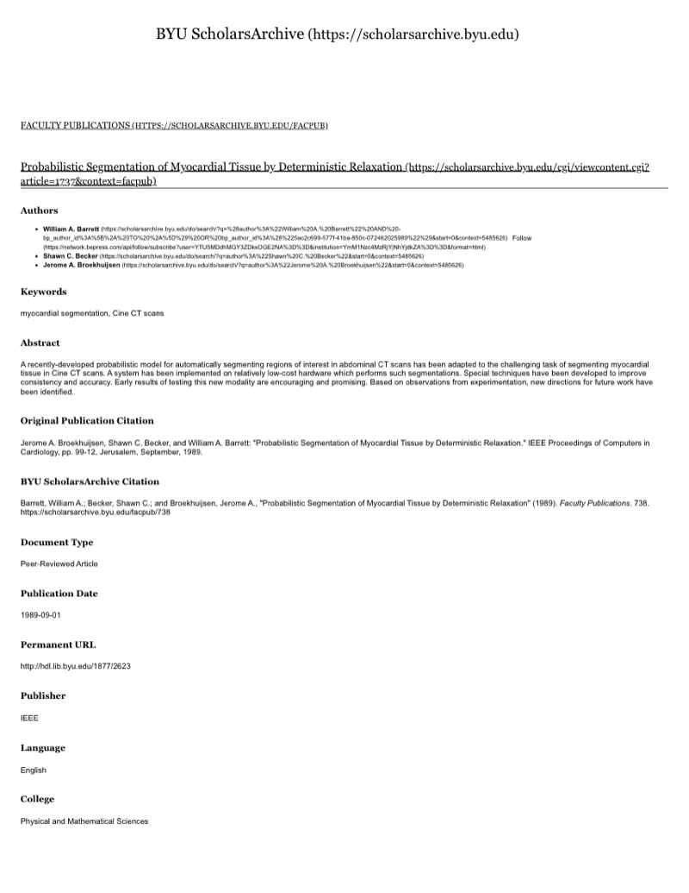

# Interactive Morphometrics from Three-Dimensional Surface Images

Research by Shawn C. Becker with William A. Barrett, Department of Computer Science, Brigham Young University, 1989–1990. Two papers from that work are in this repository. The first measures anatomy directly on rendered 3-D surfaces. The second segments myocardial tissue in cine CT.

Source: [scholarsarchive.byu.edu/facpub/733](https://scholarsarchive.byu.edu/facpub/733)

## Surface images

A surface image is a rendered view of a surface inside a 3-D image volume. The method applies to surface rendering or volume rendering, as long as the view has an apparent surface. Medical surfaces are treated as tissue interfaces. Apparent mixing at a boundary is a partial-volume effect of the detector, not overlapping tissue types.

The surface extraction pipeline has four steps: format the volume as a cubic voxel array, segment object from background, track the object surface, and render one or more views. The surface description stores the position and orientation of each voxel face on the boundary (x, y, z and dx, dy, dz). That description is a nearest-voxel foundation. Rendered intensity is then built by estimating the surface normal, using image-space shading, contextual shading, or density-gradient shading, so the picture can show detail finer than the discrete surface itself.

Rendering is too slow for the interaction rate the tools need, so a matrix of tilts and spins is rendered ahead of time from a set of view transforms. The user picks a view from that set. Each view keeps a depth buffer and the inverse of its view transform, which turns a pixel and its z value back into a world coordinate on the surface.

## Interactive points and probes

Points, linear probes, curves, planes, and volumes are placed on or through the surface and composited with the depth buffer. Only the added primitive is sent through the viewing pipeline. The surface image is not rendered again.

A click with a 2-D cursor deposits a surface point on the visible surface. Dragging moves it along the surface. The point is stored in world coordinates and sent back through that view's transform, so it stays attached to the anatomy when the view changes. It is drawn as a spherical bead with its own image and depth, then composited into the surface. World coordinates can be reported in voxels or in centimeters, using the acquisition resolution of the volume. A surface normal can be taken from the depth-buffer gradient, from the surface description, or by resampling neighboring voxels.

When a finer position is needed, the original gray values of neighboring voxels are resampled in the column that projects to that pixel. A convolution matched to the gray values around the discrete boundary is applied along that column. The position that maximizes the convolution is the sub-voxel location of the surface.

A linear probe is a 3-D line stretched between an anchor point and a moving endpoint, like a rubber band. Endpoint depth comes from the depth buffer. A modified digital differential analyzer fills the pixels and depths between them. Compositing the line into the surface makes it appear to penetrate intervening surfaces, which supplies depth for placement. Euclidean distance is taken in world coordinates and stays valid as the view changes. A curve is either a chain of head-to-tail probes or a probe projected onto the surface, like a tape laid on the anatomy, with length summed along the visible surface points. A point can also be constrained to slide along a probe. Where that point must remain visible inside the object, the surface is shown with alpha blending.

## Sectioning and partial volume

Planes are specified from the same points and probes. An orthogonal plane uses a probe along a major axis and a point that slides along it. A general plane uses an arbitrary probe as its normal: sliding the point translates the plane, and moving an endpoint pivots it. Three noncollinear points, two fixed and one moving, define a tilting plane.

Forward differences fill the plane's depth at each pixel. Those depths are compared with the surface depth buffer. Pixels where the two depths meet can be highlighted as the intersection. Surface pixels behind the plane can be recolored so the plane reads as a transparent sheet. If the original densities may be resampled, a front clipping plane replaces the view with the density on the plane where the surface lies in front of it, and a back clipping plane does the reverse, so the surface is seen in the surrounding tissue. The same planes can rewrite the depth buffer and mark a new volume of interest.

Volume of the whole surface is an integral over the surface description along one axis, and it does not have to be interactive. A partial volume, such as the left ventricle separated from atrium and aorta, is obtained without tracking or rendering the surface again. Each surface face is tested against an interactively placed cutting plane and added to one side or the other. The face coordinate with the smallest slope is the one summed, so the plane is not edged-on. Several half-spaces, or a curve swept around a probe, can isolate a smaller piece. Those logical volumes are shown with the same depth-buffer plane views.

## Myocardial segmentation

Jerome A. Broekhuijsen, Shawn C. Becker, and William A. Barrett adapted Karssemeijer's deterministic-relaxation organ segmentation from 3-D abdominal CT to 2-D myocardial CT. The local file is the ScholarsArchive record. The notes below follow the paper's method.

The scans are cine CT of the heart, using mid-heart end-diastole slices. The target is myocardial segmentation where only natural contrast separates adjoining tissues. In the contrast-enhanced case, intensity thresholding isolates the endocardial surface. Landmark alignment uses the spinal canal and the top of the heart wall. CT density is normalized by a linear ramp between lung (air) and bone, with clipping. Spatial scale is normalized by subsampling. Bilinear interpolation is avoided so that no new densities appear at tissue boundaries.

Labeling is Bayesian. The class probability is the voxel's intensity given its label, times the probability of that label given its neighbors. Priors come from both position and density. Neighborhood interaction is a count of neighboring labels plus a class-to-class boundary interaction table. Six classes are used: myocardium, blood, bone, interstitial tissue, miscellaneous tissue, and lung. Relaxation seeds each pixel from the training priors, recomputes the probabilities, assigns the pixel to the maximum class, replaces the priors, and stops at convergence. Overly polarized position priors are reduced so that boundaries can still move on later iterations.

The implementation is a four-part pipeline: manual segmentation, training-set construction, prior calculation, and automated segmentation. Manual labels are painted into an overlay buffer. Each new segmentation can be folded back into the training set. Interaction parameters stay fixed, and the training set is left extensible. Abnormal cases, including aneurysms, were used to judge accuracy and how many iterations were required. The segmentation runs on relatively low-cost hardware. Uses named for the result are wall-thickening measurement, myocardial perfusion estimation, and 3-D/4-D display of the myocardial surface.

## Papers

Shawn C. Becker and William A. Barrett, *Interactive Morphometrics from Three-Dimensional Surface Images*, IEEE Proceedings of The First Conference on Visualization in Biomedical Computing, pp. 418–425, May 1990. A local copy is [`interactive-morphometrics.pdf`](interactive-morphometrics.pdf). The first page of that file is the BYU ScholarsArchive record; the IEEE article follows in the same PDF. [ScholarsArchive](https://scholarsarchive.byu.edu/facpub/733).

Jerome A. Broekhuijsen, Shawn C. Becker, and William A. Barrett, *Probabilistic Segmentation of Myocardial Tissue by Deterministic Relaxation*, IEEE Computers in Cardiology, Jerusalem, September 1989. The local file [`myocardial-segmentation-scholarsarchive.pdf`](myocardial-segmentation-scholarsarchive.pdf) is the ScholarsArchive record, not the article. [ScholarsArchive](https://scholarsarchive.byu.edu/facpub/738).

## Skills

Interactive morphometrics on rendered 3-D surfaces:

3D Surface Images · 3D Medical Imaging · Scientific Visualization · Surface Rendering · Volume Visualization · Surface Extraction · Density Gradient Shading · Depth Buffers · Z-Buffer Compositing · Interactive Morphometrics · Interactive Points · Linear Probes · Sectioning · Sub-voxel Localization

Myocardial segmentation in cine CT:

Cine CT · Myocardial Segmentation · Natural Tissue Contrast · Contrast-enhanced Imaging · Landmark Alignment · CT Density Normalization · Spatial Scale Normalization · Deterministic Relaxation · Bayesian Labeling · Position and Density Priors · Neighborhood Interaction · Six-class Tissue Labeling · Iterative Relaxation · Training-set Construction · Incremental Learning

## Paper snapshots

*Interactive Morphometrics from Three-Dimensional Surface Images*, Shawn C. Becker and William A. Barrett, 1990. The pictured page is the ScholarsArchive cover that opens the article.

ScholarsArchive record for *Probabilistic Segmentation of Myocardial Tissue by Deterministic Relaxation*, Jerome A. Broekhuijsen, Shawn C. Becker, and William A. Barrett, 1989. The local PDF is the archive cover sheet.

## Keywords

3-D medical imaging, scientific visualization, surface rendering, volume rendering, voxel arrays, segmentation, surface tracking, density gradient shading, depth buffer, z-buffer compositing, interactive morphometrics, surface points, linear probes, curves, planes, sectioning, view transforms, sub-voxel localization, surface normals, partial volumes, cine CT, myocardial tissue, deterministic relaxation, Bayesian labeling, probabilistic segmentation.
