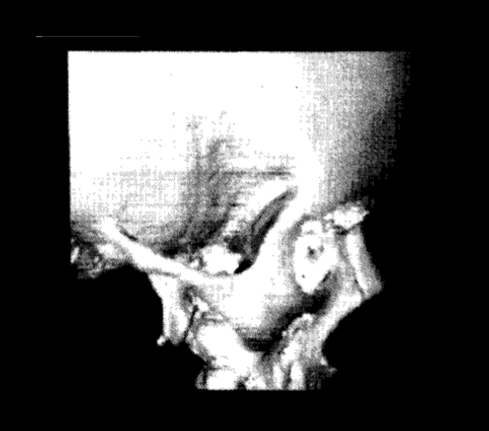
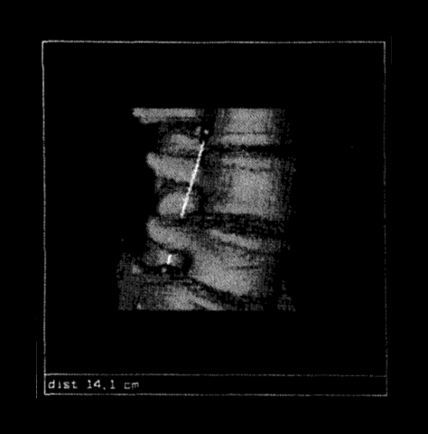
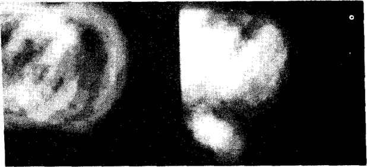
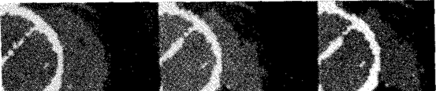

# Shawn Becker — 3-D Medical Imaging at BYU: Interactive Morphometrics and Myocardial Segmentation

Two medical imaging papers by Shawn C. Becker with William A. Barrett and Jerome A. Broekhuijsen, Department of Computer Science, Brigham Young University, 1989–1990. Both work with CT scans of human anatomy, but they attack different problems and can be read separately.

- **[Part 1 — Interactive morphometrics](#part-1--interactive-morphometrics-from-three-dimensional-surface-images)** is about interactive 3-D interfaces: measuring anatomy by placing points, probes, and cutting planes directly on rendered surface images, at interactive speed.
- **[Part 2 — Myocardial segmentation](#part-2--probabilistic-segmentation-of-myocardial-tissue-by-deterministic-relaxation)** is about analytical segmentation: labeling heart-wall tissue in cine CT automatically, with a Bayesian model refined by iterative relaxation.

| | Paper | Year | Venue |
|---|---|---|---|
| Part 1 | *Interactive Morphometrics from Three-Dimensional Surface Images* | 1990 | IEEE Conference on Visualization in Biomedical Computing |
| Part 2 | *Probabilistic Segmentation of Myocardial Tissue by Deterministic Relaxation* | 1989 | IEEE Computers in Cardiology |

---

## Part 1 — Interactive morphometrics from three-dimensional surface images

*Figure 1: a skull surface image with density-gradient shading. Figure 2: two surface points and a linear probe measuring 14.1 cm on a vertebra.*

Rendering a 3-D surface from a CT volume was far too slow to redo on every mouse move, so measurement tools had to work on images that were already rendered. Each pre-rendered view keeps its depth buffer and the inverse of its view transform, which turns any clicked pixel back into a 3-D point on the anatomy.

Measurement primitives are drawn into the view and composited through the depth buffer, so only the primitive is rendered, never the surface. Surface points stay attached to the anatomy when the view changes and can be refined to sub-voxel accuracy. A linear probe between two points reports true 3-D distance, and cutting planes that slide, pivot, or tilt through the volume can expose the original densities or split off a partial volume, such as the left ventricle, without re-rendering.

### Paper

Shawn C. Becker and William A. Barrett, *Interactive Morphometrics from Three-Dimensional Surface Images*, IEEE Proceedings of The First Conference on Visualization in Biomedical Computing, pp. 418–425, May 1990. [ScholarsArchive record](https://scholarsarchive.byu.edu/facpub/733) · <a href="interactive-morphometrics.pdf" target="_blank" rel="noopener">open the PDF</a>.

Follow-on journal article: Shawn Becker, William A. Barrett, and Dan R. Olsen, *Interactive Measurement of Three-Dimensional Objects Using a Depth Buffer and Linear Probe*, ACM Transactions on Graphics, Vol. 10, No. 2, April 1991.

---

## Part 2 — Probabilistic segmentation of myocardial tissue by deterministic relaxation

*Figure 6: initial position probabilities for myocardial tissue (left) and blood pool (right) from the extended training set. Figure 7: myocardial tissue probabilities over the first three iterations on an image outside the training set; the myocardium sharpens, especially in the septal and posterior walls.*

Segmenting the heart wall in cine CT is hard because, without contrast enhancement, the myocardium and its neighboring tissues differ only slightly in density. The paper adapts Karssemeijer's deterministic-relaxation method from 3-D abdominal CT to 2-D mid-heart slices, after aligning each scan on anatomical landmarks and normalizing its density and scale.

Each pixel is labeled as one of six tissue classes (myocardium, blood, bone, interstitial tissue, miscellaneous tissue, or lung) by a Bayesian model that combines position and density priors learned from hand-labeled scans with the labels of its neighbors. Relaxation repeats that estimate until the labels converge, and each new segmentation can be added back to the training set. Tests included abnormal hearts with aneurysms, and the system ran on relatively low-cost hardware. Intended uses were wall-thickening measurement, perfusion estimation, and 3-D/4-D display of the myocardium.

### Paper

Jerome A. Broekhuijsen, Shawn C. Becker, and William A. Barrett, *Probabilistic Segmentation of Myocardial Tissue by Deterministic Relaxation*, IEEE Computers in Cardiology, pp. 99–102, Jerusalem, September 1989. [ScholarsArchive record](https://scholarsarchive.byu.edu/facpub/738) · <a href="myocardial-segmentation.pdf" target="_blank" rel="noopener">open the PDF</a>.

---

## Skills and keywords

- **Medical imaging:** 3D Medical Imaging · Cine CT · Myocardial Tissue · Natural Tissue Contrast · Contrast-enhanced Imaging · Segmentation
- **Surface extraction and rendering:** 3D Surface Images · Scientific Visualization · Surface Rendering · Volume Rendering · Volume Visualization · Voxel Arrays · Surface Extraction · Surface Tracking · Density Gradient Shading · Surface Normals · View Transforms
- **Interactive measurement:** Interactive Morphometrics · Depth Buffers · Z-Buffer Compositing · Interactive Points · Surface Points · Linear Probes · Curves · Planes · Sectioning · Sub-voxel Localization · Partial Volumes
- **Image normalization:** Landmark Alignment · CT Density Normalization · Spatial Scale Normalization
- **Probabilistic segmentation:** Myocardial Segmentation · Probabilistic Segmentation · Deterministic Relaxation · Iterative Relaxation · Bayesian Labeling · Position and Density Priors · Neighborhood Interaction · Six-class Tissue Labeling
- **Training:** Training-set Construction · Incremental Learning
